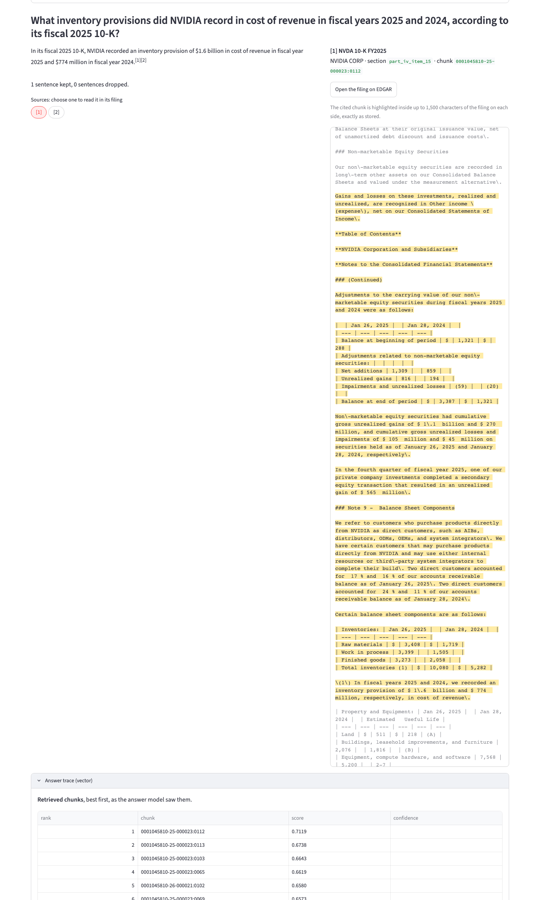

# FilingIntel

FilingIntel answers questions about what NVIDIA, AMD and Intel disclose in their 10-K and 10-Q filings, and every sentence in an answer cites the exact filing passage it came from. It compares four ways of finding those passages (vector search, an entity graph searched by neighbourhood, Cypher written by an LLM, and community summaries) plus a router that picks between them, on one set of questions with a held-out split. On that benchmark, plain vector search beat every graph method; this README says by how much and what the graph cost.



## Results on the held-out split

Every number in this section and in [the numbers most projects don't publish](#numbers-most-projects-dont-publish) is generated from committed run files by `python -m eval.results_table`, and CI fails if they drift. The full tables, per-class intervals, hypotheses and `dev` tuning data are in [benchmarks/results.md](benchmarks/results.md).

<!-- BEGIN test-headline: generated by python -m eval.results_table; edit the code, not this block -->
`test` split: 47 agent-drafted questions (38 answerable), scored once with `--final` at `f761581`. Recall is gold chunks in the top 10. Judged columns come from gpt-6-luna and are uncalibrated. A class under 10 questions is directional. Intervals are fixed-seed bootstrap 95%; a paired difference counts only when its interval excludes 0.

| row | lookup (n 13) | local (n 13) | multi_hop (n 7, directional) | global (n 5, directional) | pooled recall@10 [95%] | vs vector [95%] | faithfulness (uncalibrated) | cost / question (USD) | p95 total ms |
| --- | --- | --- | --- | --- | --- | --- | --- | --- | --- |
| vector | 1.000 | 0.962 | 0.798 | 0.800 | 0.923 [0.864, 0.974] | - | 0.959 [0.913, 0.993] | 0.0313 | 11,641 |
| graph_local | 1.000 | 0.500 | 0.500 | 0.067 | 0.614 [0.469, 0.754] | -0.309 [-0.439, -0.184] | 0.921 [0.862, 0.970] | 0.0300 | 9,912 (38 replayed) |
| graph_traversal | 0.923 | 0.731 | 0.524 | 0.267 | 0.697 [0.561, 0.820] | -0.226 [-0.351, -0.110] | 0.966 [0.924, 0.991] | 0.0315 | 23,126 (38 replayed) |
| graph_global | 0.308 | 0.654 | 0.357 | 0.333 | 0.439 [0.298, 0.583] | -0.485 [-0.623, -0.349] | retrieval only | retrieval only | retrieval only |
| router (pre-registered) | 1.000 | 0.500 | 0.524 | 0.333 | 0.654 [0.522, 0.776] | -0.270 [-0.399, -0.149] | 0.952 [0.903, 0.988] | 0.0390 | 4,090 (38 replayed) |
| router (dev-best) | 1.000 | 0.500 | 0.500 | 0.800 | 0.711 [0.579, 0.833] | -0.213 [-0.336, -0.101] | 0.930 [0.876, 0.975] | 0.0303 | 747 (38 replayed) |

graph_global answered only some classes on `test`: 33 of 38 answerable questions were scored retrieval only, so its pooled faithfulness, cost and latency are not given.

Decline (4) and unanswerable (5) questions, judged (uncalibrated), directional: every row declined the advice questions and said the filings lack the answer to the unanswerable ones.
<!-- END test-headline -->

A latency marked "replayed" reused cached calls. The graph arms reused vector's cached query embeddings, so their totals run a few hundred milliseconds low; both routers replayed every arm's answer, so their latency is replay time, not end to end.

## What the results say

Vector search won. On the 38 answerable `test` questions it found 0.923 of the gold passages in its top 10. Every graph arm and both routers found fewer, and every pooled difference has an interval that excludes 0. The graph itself was built cleanly: no ontology violation reached the write path, and every one of global search's citations traced back through the graph to a filing chunk. Cleanliness was not the problem. Retrieval was.

- **Lookups are easy.** Every arm except global search found the gold passage for all or nearly all 13 lookup questions. Single facts don't need a graph.
- **Local questions are where dev and `test` parted.** The entity-linking arm (`graph_local`) found 0.909 of local gold passages on `dev` and 0.500 on `test`, with every setting frozen before `test`. It was not retuned. Both routers send local questions to it, so they inherit the loss.
- **Multi-hop, the case Cypher traversal was built for, still went to vector:** 0.524 against 0.798, a difference of −0.274 [−0.571, 0.012]. The interval reaches 0 and there are only 7 questions, so this is directional, not a finding.
- **Community summaries lost on the questions built for them.** On global questions, map-reduce over community reports found 0.333 of the gold passages against vector's 0.800 on `test` (5 questions, directional) and 0.458 against 0.800 on `dev` (10 questions). The judge, uncalibrated, found its cited sentences less often supported by their chunks than vector's (−0.180 on `test`). It also cost about $0.09 a question, two to three times the other arms.
- **The router was accurate and it didn't matter.** It picked the right class for 38 of 42 `test` questions, and its pooled recall equalled an oracle router given every gold class (0.654). Its mistakes cost nothing because the arms its pre-registered map routes to were the ones losing. The dev-best map sends global questions to vector and scores higher (0.711), but it was tuned on `dev`.
- **Judged columns are uncalibrated.** The user did not score the calibration draw, so faithfulness, relevancy and citation support are gpt-6-luna's numbers, unchecked against a person. A corruption test shows the judge catches most planted errors (below), which is evidence it reads the answers, not that its scores match a human's.

All questions are agent-drafted: 140 questions that agents wrote with their gold chunks, used without human review, 47 of them held out as `test`. That is the largest caveat on every number here.

## Architecture

- **Ingest:** 24 filings from EDGAR (rate-limited, cached), parsed with edgartools into sections whose character offsets are correct by construction, chunked by section and stored in Postgres. `resolve(chunk_id)` returns the exact cited text.
- **Vector arm:** voyage-4-large embeddings in pgvector, exact search, a company and period filter read from the question.
- **Graph:** claude-haiku-5-5 extracts entities and edges per chunk; every node and edge stores the chunk and span that evidence it, and the write path rejects anything without one. Entity resolution merges names across filings through an append-only merge log. Leiden finds two levels of communities, and each gets a cited report. Neo4j holds it all.
- **Graph arms:** `graph_local` (anchor entities, one hop, chunks ranked by edge support), `graph_traversal` (guarded text-to-Cypher with one repair and a fallback) and `graph_global` (map-reduce over community reports). Each hands at most 10 chunks to the same answer prompt as vector search.
- **Router:** a claude-haiku-5-5 classifier sends each question to an arm by class, and declines investment advice itself.
- **Answers:** claude-sonnet-5-5 writes them; any sentence without a citation to a retrieved chunk is dropped before display.
- **Evaluation:** a harness scoring retrieval from chunk IDs, judged metrics through Ragas and gpt-6-luna, cost and latency, with paired bootstrap intervals; an offline retrieval gate in CI; Phoenix tracing.

[docs/ARCHITECTURE.md](docs/ARCHITECTURE.md) has the diagram and [docs/GRAPH-LAYER.md](docs/GRAPH-LAYER.md) the graph design.

## Numbers most projects don't publish

<!-- BEGIN unpublished-numbers: generated by python -m eval.results_table; edit the code, not this block -->
| figure | value | label | source | detail |
|---|---|---|---|---|
| Entity resolution precision | 1.000 [1.000, 1.000] | agent-labelled (gpt-6-luna), 100 pairs, round 2 (group cut) | `benchmarks/resolution/scoring2-score1.json` at `99882ce` | [results.md](benchmarks/results.md#entity-resolution) |
| Entity resolution recall | 0.783 [0.600, 0.947] | agent-labelled (gpt-6-luna), 100 pairs, round 2 (group cut) | `benchmarks/resolution/scoring2-score1.json` at `99882ce` | [results.md](benchmarks/results.md#entity-resolution) |
| Cypher validity, first pass | 88 of 93 (0.946) | dev, agent-drafted, `cypher/v1@44e50e3f` (the one the arm uses) | `benchmarks/graph/cypher-validity-run1.json` at `5a1681d` | [results.md](benchmarks/results.md#cypher-validity) |
| Cypher validity, after one repair | 93 of 93 (1.000) | dev, agent-drafted, `cypher/v1@44e50e3f` (the one the arm uses) | `benchmarks/graph/cypher-validity-run1.json` at `5a1681d` | [results.md](benchmarks/results.md#cypher-validity) |
| Router accuracy on `test` | 38 of 42, 0.905 [0.779, 0.962] (Wilson) | against agent-drafted class labels | `benchmarks/runs/2026-10-19-router-pre_registered-test-f761581.json` at `f761581` | [results.md](benchmarks/results.md#router-accuracy-on-test) |
| Extraction ontology violations reaching the write path | 0 of 26,915 (0.000) | candidate triples, all 24 filings | latest `extract/v2` run of each of 24 filings at `67662a2` | [results.md](benchmarks/results.md#extraction) |
| Extraction candidates rejected before the write path | 327 of 26,915 (0.012) | mostly spans not found in their chunk, and edges to a rejected node | latest `extract/v2` run of each of 24 filings at `67662a2` | [results.md](benchmarks/results.md#extraction) |
| Extraction review round 2 (Step 8) | 1.000 [0.886, 1.000] (Wilson) | the user's judgment of 30 sampled edges | `benchmarks/extraction/0001045810-26-000021-round2.jsonl` at `d4cf18e` | [results.md](benchmarks/results.md#extraction) |
| Extraction review round 3 (Step 9) | 1.000 [0.886, 1.000] (Wilson) | the user's judgment of 30 sampled edges | `benchmarks/extraction/0000002488-26-000018-round1.jsonl` at `3fd49ff` | [results.md](benchmarks/results.md#extraction) |
| Risk-factor persistence precision | 0.958 [0.864, 1.000] | agent-labelled (gpt-6-luna), 100 pairs | `benchmarks/persistence/scoring-score1.json` at `26f1299` | [results.md](benchmarks/results.md#risk-factor-persistence-links) |
| Risk-factor persistence recall | 0.428 [0.298, 0.572] | agent-labelled (gpt-6-luna), 100 pairs | `benchmarks/persistence/scoring-score1.json` at `26f1299` | [results.md](benchmarks/results.md#risk-factor-persistence-links) |
| graph_global citations that do not trace to a selected community (dev) | 0 breaks in 163 | agent-drafted questions | `benchmarks/graph/global-provenance-run2.json` at `d2f3fa1` | [results.md](benchmarks/results.md#graph_global-provenance) |
| graph_global citations that do not trace to a selected community (test) | 0 breaks in 82 | agent-drafted questions | `benchmarks/graph/global-provenance-run3.json` at `4579da0` | [results.md](benchmarks/results.md#graph_global-provenance) |
| Judge catches a planted changed number | faithfulness 23 of 24; citation support 24 of 24 | corruption test on 30 dev answers, not calibration | `benchmarks/calibration/corruption-run1.json` at `8ed7350+dirty` | [results.md](benchmarks/results.md#judge-calibration) |
| Judge catches a planted swapped period | faithfulness 16 of 18; citation support 18 of 18 | corruption test on 30 dev answers, not calibration | `benchmarks/calibration/corruption-run1.json` at `8ed7350+dirty` | [results.md](benchmarks/results.md#judge-calibration) |
| Judge catches a planted wrong citation | faithfulness 0 of 29; citation support 29 of 29 (a control: faithfulness ignores citations) | corruption test on 30 dev answers, not calibration | `benchmarks/calibration/corruption-run1.json` at `8ed7350+dirty` | [results.md](benchmarks/results.md#judge-calibration) |
| Judge catches a planted added sentence | faithfulness 29 of 30; citation support 30 of 30 | corruption test on 30 dev answers, not calibration | `benchmarks/calibration/corruption-run1.json` at `8ed7350+dirty` | [results.md](benchmarks/results.md#judge-calibration) |
<!-- END unpublished-numbers -->

## What I'd do differently

- **Ask whether vector search had headroom before building the graph.** On `dev`, vector already found every lookup passage and 0.977 of local ones. The room to win was only in multi-hop and global questions, 33 of the 82 answerable `dev` questions. A small probe, hand-written Cypher against those questions' gold passages, would have tested the graph's ceiling before extraction, resolution and communities were built.
- **Write or verify the questions by hand.** Agent-drafted questions made the benchmark possible on this budget, but they cap what it can claim. With 7 multi-hop and 5 global `test` questions, the classes the graph was meant to win are directional at best. I'd spend the extra day on 30 human-checked questions per class.
- **Calibrate the judge before reporting judged scores.** The tools and the draw are committed, and the scoring took longer than the time I set aside. Until it is done, the judged columns are a model's opinion.
- **Give the graph arms the graph.** Every graph arm hands the same answer prompt nothing but chunk text. The paths that made a chunk relevant never reach the answer model, so the comparison is between retrievers, not between graph and vector answering. Path context was deferred to keep the comparison clean, and it is the first thing I'd test next.
- **Model risk factors as many-to-many from the start.** The persistence linker allowed each risk factor one predecessor. Filers merge and split risk factors, and that rule explains 9 of the 21 true links it missed in the scored sample (recall 0.428).

## Running it

Needs Docker, [uv](https://docs.astral.sh/uv/) and a `.env` made from `.env.example`. `EDGAR_USER_AGENT` must hold a real name and email, as the SEC requires. Downloaded filings, extraction output and the API response cache live in `data/`, which is not committed, so a fresh clone rebuilds them and the paid steps cost money.

```bash
docker compose up -d
```

```bash
uv run --env-file .env python -m ingest.corpus
```

```bash
uv run --env-file .env python -m ingest.load --verify
```

```bash
uv run --env-file .env python -m ingest.embed
```

```bash
uv run --env-file .env streamlit run ui/app.py
```

The first command starts Postgres, Neo4j and Phoenix. The next three download and parse the filings, load Postgres and check `resolve()` on every chunk, and embed the chunks (Voyage, paid). The last opens the app at http://127.0.0.1:8501. The vector arm works from there; the graph arms and the router need extraction, entity resolution, persistence links, communities, reports and a graph load first, whose commands are listed in [CLAUDE.md](CLAUDE.md) under Commands. Tests run with `uv run --env-file .env pytest`.

## Scope

Three companies, 10-K and 10-Q filings only, two fiscal years each. This is a research and engineering project and gives no investment advice: the router declines such questions. Stack: Python, Postgres with pgvector, Neo4j Community, Ragas, Phoenix, GitHub Actions and Streamlit.

The code is MIT licensed ([LICENSE](LICENSE)). The filings are SEC public records, and the eval questions are agent-drafted, not written or reviewed by a person.
