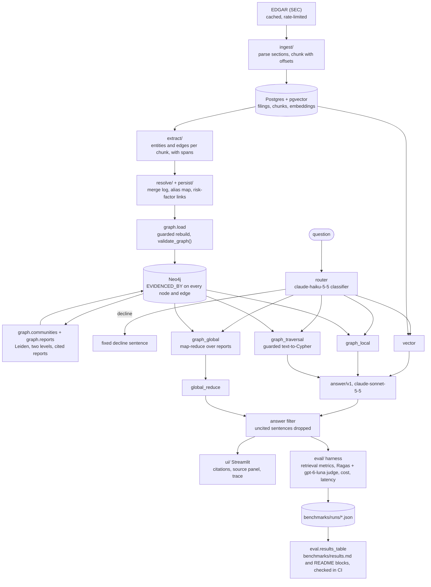

# FilingIntel — Architecture

System overview. Read with `CLAUDE.md` (rules and decisions), `docs/RUNBOOK.md` (build order and stop conditions) and `docs/GRAPH-LAYER.md` (graph design detail). Where this file and CLAUDE.md differ, CLAUDE.md wins.

---

## What the system does

A user asks a question about what NVDA, AMD or INTC disclose in their 10-K and 10-Q filings. The system retrieves supporting text, generates an answer, and attaches a citation to every claim. Each citation resolves to an exact character span in the original filing.

The project exists to produce an honest, reproducible comparison of retrieval strategies on one fixed eval set, including where graph retrieval loses to plain vector search. The eval set is 140 agent-drafted questions used without human review (CLAUDE.md, invariant 1), and every result says so. Every component serves that comparison.

---

## Components

Every retrieval, routing and generation call can emit a Phoenix span (off unless `PHOENIX_COLLECTOR_ENDPOINT` is set).

### Ingest
Enumerate filings from the EDGAR submissions API, download raw HTML once into `data/raw/` keyed by accession number, and parse to text with section boundaries preserved. Raw files are never re-downloaded during development. `python -m ingest.corpus` picks the manifest (network), reports on it and writes each parsed filing to `data/parsed/{accession_no}.json`; `python -m ingest.load` loads Postgres from those files offline.

### Index
- **Chunks** are section-aware (never span an Item boundary), at most 800 cl100k_base tokens with up to 100 tokens of text overlap, and tables are kept intact (a table chunk may exceed 800). Tables are located by their position in the parsed text. Each chunk stores `chunk_id` (`{accession_no}:{ordinal:04d}`), `cik`, `accession_no`, `form_type`, `fiscal_period`, `section`, `char_start` and `char_end`, plus `token_count`, `tokenizer`, `chunker_version` and `contains_table`, in the Postgres `chunks` table (`db/schema.sql`).
- **`resolve(chunk_id)`** returns the exact source text: `substr` of the filing's full parsed text, stored once in the `filings` table with its SHA-256. Chunk text is not stored separately. Citations, evals and the UI all depend on it; `python -m ingest.load --verify` checks it on the whole corpus.
- **Embeddings** live in pgvector alongside the chunk table.
- **Graph** (v2) lives in Neo4j. Ontology, extraction, entity resolution and the provenance rule are specified in `docs/GRAPH-LAYER.md`.
- **Communities** (v2) are computed with Leiden (`graspologic-native`) in Python, at two levels, over extracted nodes other than metric values. Each gets a report, stored on its `:Community` node in Neo4j with the membership; report embeddings sit in the disk cache and are searched exactly (ADR-0004 amendment of 2026-10-15).

### Retrieve
Four arms, each runnable on its own from the CLI (`--arm <name>`) so the benchmark can call them uniformly:

| Arm | Suited to | How it retrieves |
|---|---|---|
| `vector` | single-fact lookup | top-k over chunk embeddings, filtered by company and period |
| `graph_local` | one entity plus context | anchor entities → 1–2 hop neighbourhood → evidencing chunks |
| `graph_traversal` | multi-hop joins | hardened text-to-Cypher, falling back to `graph_local` |
| `graph_global` | corpus-wide themes | map-reduce over community reports, with map points that cite chunks (ADR-0008) |

The **router** is a plain dispatch function (Step 13; LangGraph is not used, see docs/research/router-langgraph-and-judge-calibration.md). A claude-haiku-5-5 classifier gives each question a predicted class (`lookup`, `local`, `multi_hop`, `global` or `decline`). A `decline` returns the fixed decline sentence with no retrieval; any other class goes to the arm a routing map names. Every routing decision is logged as a span, and router accuracy is measured against the eval set's gold classes. The classifier runs `route/v2` at effort `low`, both chosen on dev with `python -m eval.route`; the router is run with `eval.run --arm router --map pre_registered|dev_best`, and `benchmarks/router/frozen.json` (`python -m eval.freeze`) pins every arm, the router and both maps before `test` is scored.

### Generate
Answers are generated only from retrieved context. Every claim must cite a real chunk ID, and uncited sentences are removed before display. Graph arms hand at most 10 ranked chunks to the same answer prompt as `vector` (ADR-0007), so answers carry chunk citations, not graph paths; path context is an open decision. Answers never infer causation from co-occurrence in the graph.

### Evaluate
- **Eval set:** 140 agent-drafted questions in `eval/agent_drafted_set.jsonl` (120 answerable, labelled `lookup`, `local`, `multi_hop` or `global`, plus decline and unanswerable questions), each with gold chunk IDs pinned by SHA-256, used without human review. About 30% are held out as `test` and were scored once. `eval/eval_set.jsonl`, for human-written or human-verified questions, is empty.
- **Metrics per arm × class:** recall and precision at 5 and 10 and a wrong-evidence rate from chunk IDs; faithfulness and answer relevancy (Ragas) and citation support, judged by gpt-6-luna and uncalibrated; p50/p95 total latency and cost per question. No path precision metric was built.
- **Attribution:** every result records the commit, prompt versions and schema version, so any change in a metric can be traced to its cause.

### CI
GitHub Actions runs `ruff` and `pytest` (with Postgres and a Neo4j test instance) on every pull request and push to `main`. The quality gate (ADR-0003) runs the vector arm's real search offline over a committed snapshot of the 82 answerable `dev` questions and fails on any drop in recall@5, recall@10 or wrong-evidence rate against the committed baseline. There is no graph gate and no Cypher validity floor in CI (open decision). `benchmarks/results.md` and the README's generated blocks are built offline from the committed run files by `python -m eval.results_table`; CI rebuilds them and fails if they differ. They are never edited by hand.

### Serve
There is no HTTP layer. The Streamlit app (`ui/app.py`, local only, bound to 127.0.0.1) calls the arms in-process through `ui/backend.py`. It shows an answer with numbered citations, a source panel highlighting the cited span inside its filing, an answer trace (route, anchors and their edges, Cypher attempts, communities and map points), the gold-free numbers for every answer and the committed metrics for a sample, and a Benchmarks tab rendering `benchmarks/results.md`. Sample questions come from `dev` only and replay from the response cache. The graph is drawn only inside an answer's trace.

---

## Cross-cutting rules

These restate CLAUDE.md invariants where they shape the architecture:

- **Provenance end to end.** Answer claim → chunk ID → character span in the raw filing. For graph arms: claim → chunk → `EVIDENCED_BY` or edge evidence → node → span; for `graph_global`, claim → chunk → selected community member → `EVIDENCED_BY`. Any break in that chain is a bug.
- **Read-only at query time.** Neo4j Community has no read-only users, so generated Cypher passes five guards in code (text rules, an ontology and direction check, `EXPLAIN` plan type, a READ transaction with a timeout, a row cap) before it runs (ADR-0007).
- **Versioned prompts.** Prompts live in `prompts/` as versioned files, never inline strings.
- **Configuration from the environment.** Secrets come from environment variables and never appear in code, logs or traces.
- **The vector arm is the control.** It is never removed or degraded.

---

## Infrastructure

One `docker-compose.yml` runs Postgres (with pgvector) and Neo4j Community. Phoenix runs locally for tracing. Everything else is Python 3.11+ with pinned dependencies.

---

## Versions

- **v1 (RUNBOOK steps 1–6):** ingest, chunks, the agent-drafted eval set, the `vector` arm, the eval harness, the CI gate and tracing.
- **v2 (steps 7–13):** ontology, extraction, entity resolution, graph load, the three graph arms, the router and the full benchmark.
- **Write-up (step 14):** the UI and a README led by the `test` table and its interpretation.